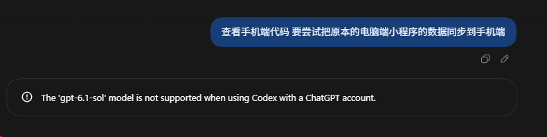

# Why GPT-6.1 Sol Doesn't Appear in ChatGPT / Codex Desktop: Root Cause Analysis & Configuration Deep Dive

[English](#english-version) | [中文说明](#chinese-version)

---

<a name="english-version"></a>
## 🇬🇧 English Version

### Summary / TL;DR
Following OpenAI's DevDay release of **GPT-6.1 Sol** (September 29, 2026), many users of the ChatGPT / Codex Windows desktop app found that GPT-6.1 was missing from the model picker.

After clearing local caches and manually injecting the model definition into the local configuration, the definitive server error was revealed:
> **`The 'gpt-6.1-sol' model is not supported when using Codex with a ChatGPT account.`**



**Conclusion:**  
GPT-6.1 Sol is currently restricted to **OpenAI API / Enterprise Developer endpoints** (Microsoft Foundry, Amazon Bedrock, OpenAI API). It is **not yet enabled for ChatGPT subscription/consumer accounts** inside the Codex desktop app.

---

### Local Architecture & Key Configuration Files (Windows)

On Windows, the OpenAI Codex / ChatGPT desktop app manages local configurations and model catalogs across several directories:

| Purpose | Local Path | Description |
| :--- | :--- | :--- |
| **Model Catalog Cache** | `%USERPROFILE%\.codex\models_cache.json` | Stores cached model metadata, ETag, reasoning effort levels, and tool configurations. |
| **App Configuration** | `%USERPROFILE%\.codex\config.toml` | Main configuration file defining the active model (`model = "gpt-6-sol"`), plugins, and MCP connections. |
| **UI Web Cache** | `%LOCALAPPDATA%\Packages\OpenAI.Codex_*\LocalCache\` | WebView2 / Chromium local storage and UI assets. |

---

### Investigation & Reverse Engineering Steps

#### 1. Invalidate Cache & Fetch Fresh Remote Models
We completely terminated the running background services (`codex-windows-sandbox-service`, `ChatGPT.exe`) and deleted `%USERPROFILE%\.codex\models_cache.json`.

Running the diagnostic tool `codex debug models` fetched the latest dynamic catalog from OpenAI's servers:
* OpenAI's server returned:
  * `gpt-6-astra`
  * `gpt-6-sol` (Noticeably, OpenAI updated its description string to: *"Previous generation workhorse model."*)
  * `gpt-6-luna`
  * `gpt-5.6-*`
* **Finding:** The backend API itself dynamically omits `gpt-6.1-sol` when queried with consumer ChatGPT account credentials.

#### 2. Manual Injection into Local Configuration
To test whether the model could be manually forced:
1. Injected a new model entry for `gpt-6.1-sol` into `%USERPROFILE%\.codex\models_cache.json` with matching reasoning levels and a 1,050,000 token context window.
2. Updated `%USERPROFILE%\.codex\config.toml` to:
   ```toml
   model = "gpt-6.1-sol"
   model_reasoning_effort = "medium"
   ```
3. Relaunched the desktop client.

#### 3. Result: UI Displays Model, Server Blocks Invocation
* **UI**: The model dropdown successfully recognized and displayed **GPT-6.1 Sol**.
* **Invocation**: Sending any message immediately returned an explicit server validation error:
  ```text
  The 'gpt-6.1-sol' model is not supported when using Codex with a ChatGPT account.
  ```

---

### Takeaway
* **Do not waste time reinstalling or endlessly clearing cache:** The absence of GPT-6.1 Sol is an intentional server-side account-tier gate, not a client bug or corrupted local cache.
* **How to use GPT-6.1 Sol today:** Use an OpenAI API key via the official API or SDK, or third-party cloud integrations (Foundry / Bedrock).

---

<a name="chinese-version"></a>
## 🇨🇳 中文说明

### 核心结论（TL;DR）
OpenAI 于 2026 年 9 月 29 日发布了新一代中阶主力模型 **GPT-6.1 Sol**（具备 105 万 Token 超大上下文、更优的代码与 Computer Use 性能，成本仅为 Astra 的五分之一）。

在 Windows 端 ChatGPT / Codex 桌面客户端中，许多用户发现模型下拉菜单中依旧只有 GPT-6 Sol、GPT-6 Astra，刷不出 6.1。

经过清理本地缓存与手动注入配置的深度测试，最终确认了服务端硬拦截原因：
> **`The 'gpt-6.1-sol' model is not supported when using Codex with a ChatGPT account.`**  
> （在 Codex 客户端中使用 ChatGPT 账号时，不支持 'gpt-6.1-sol' 模型）

**结论：** GPT-6.1 Sol 当前是**面向 API / 开发者（OpenAI API、Microsoft Foundry、Amazon Bedrock）**专属放量的模型，**尚未对 ChatGPT 个人/订阅账号开放端侧使用**。

---

### Windows 本地关键配置文件路径

| 文件类别 | 路径 | 作用说明 |
| :--- | :--- | :--- |
| **模型缓存清单** | `%USERPROFILE%\.codex\models_cache.json` | 保存从云端获取的模型定义、ETag、推理档位及工具链权限 |
| **核心配置文件** | `%USERPROFILE%\.codex\config.toml` | 控制默认加载模型（如 `model = "gpt-6-sol"`）、MCP 与沙箱模式 |
| **前端界面缓存** | `%LOCALAPPDATA%\Packages\OpenAI.Codex_*\LocalCache\` | 存储桌面端 WebView2 / Electron 前端状态与渲染缓存 |

---

### 排查过程与实测记录

1. **缓存清理与云端清单比对**：  
   清空本地 `models_cache.json` 并调用 `codex debug models` 直接直连云端无缓存拉取，发现云端返回的数据中 `gpt-6-sol` 的描述已经被官方修改为 *"Previous generation workhorse model"*（上一代主力模型），但可用列表中明确没有下发 `gpt-6.1-sol`。
2. **本地配置强行注入**：  
   在 `models_cache.json` 中仿造 6 系列参数注入 `gpt-6.1-sol`，并在 `config.toml` 中配置 `model = "gpt-6.1-sol"`。
3. **测试结果**：  
   桌面端成功识别并在下拉框中渲染出了 **GPT-6.1 Sol**，但发送指令后，服务端即时返回阻断报错：`The 'gpt-6.1-sol' model is not supported when using Codex with a ChatGPT account.`。

---

### 开发者建议
1. 客户端刷不出 6.1 不是本地缓存损坏或软件安装问题，无需反复重装应用。
2. 如需体验 GPT-6.1 Sol，请直接使用 API Key 方式调用官方 API 或通过微软 Foundry / 亚马逊 Bedrock 体验。
